<picture>
  <source media="(prefers-color-scheme: dark)" srcset="./banner-dark.svg">
  <source media="(prefers-color-scheme: light)" srcset="./banner-light.svg">
  
</picture>

<picture>
  <source media="(prefers-color-scheme: dark)" srcset="./marquee-dark.svg">
  <source media="(prefers-color-scheme: light)" srcset="./marquee-light.svg">
  
</picture>

 

<picture>
  <source media="(prefers-color-scheme: dark)" srcset="./h-work-dark.svg">
  <source media="(prefers-color-scheme: light)" srcset="./h-work-light.svg">
  
</picture>

<table width="100%" cellspacing="0" cellpadding="0">
<tr>
<td rowspan="2" width="50%" valign="top">
<picture>
  <source media="(prefers-color-scheme: dark)" srcset="./plate-laborloom-dark.svg">
  <source media="(prefers-color-scheme: light)" srcset="./plate-laborloom-light.svg">
  
</picture>
</td>
<td width="50%" valign="top">
<picture>
  <source media="(prefers-color-scheme: dark)" srcset="./plate-threadco-dark.svg">
  <source media="(prefers-color-scheme: light)" srcset="./plate-threadco-light.svg">
  
</picture>
</td>
</tr>
<tr>
<td valign="top">
<picture>
  <source media="(prefers-color-scheme: dark)" srcset="./plate-genai-dark.svg">
  <source media="(prefers-color-scheme: light)" srcset="./plate-genai-light.svg">
  
</picture>
</td>
</tr>
</table>

<picture>
  <source media="(prefers-color-scheme: dark)" srcset="./divider-dark.svg">
  <source media="(prefers-color-scheme: light)" srcset="./divider-light.svg">
  
</picture>

<picture>
  <source media="(prefers-color-scheme: dark)" srcset="./h-stack-dark.svg">
  <source media="(prefers-color-scheme: light)" srcset="./h-stack-light.svg">
  
</picture>

<picture>
  <source media="(prefers-color-scheme: dark)" srcset="./stack-dark.svg">
  <source media="(prefers-color-scheme: light)" srcset="./stack-light.svg">
  
</picture>

<picture>
  <source media="(prefers-color-scheme: dark)" srcset="./divider-dark.svg">
  <source media="(prefers-color-scheme: light)" srcset="./divider-light.svg">
  
</picture>

<picture>
  <source media="(prefers-color-scheme: dark)" srcset="./h-exp-dark.svg">
  <source media="(prefers-color-scheme: light)" srcset="./h-exp-light.svg">
  
</picture>

<picture>
  <source media="(prefers-color-scheme: dark)" srcset="./experience-dark.svg">
  <source media="(prefers-color-scheme: light)" srcset="./experience-light.svg">
  
</picture>

<picture>
  <source media="(prefers-color-scheme: dark)" srcset="./divider-dark.svg">
  <source media="(prefers-color-scheme: light)" srcset="./divider-light.svg">
  
</picture>

<picture>
  <source media="(prefers-color-scheme: dark)" srcset="./h-num-dark.svg">
  <source media="(prefers-color-scheme: light)" srcset="./h-num-light.svg">
  
</picture>

<picture>
  <source media="(prefers-color-scheme: dark)" srcset="./numbers-dark.svg">
  <source media="(prefers-color-scheme: light)" srcset="./numbers-light.svg">
  
</picture>

 

<picture>
  <source media="(prefers-color-scheme: dark)" srcset="./footer-dark.svg">
  <source media="(prefers-color-scheme: light)" srcset="./footer-light.svg">
  
</picture>

<!-- Add your real profile links here, then remove this comment:

-->

